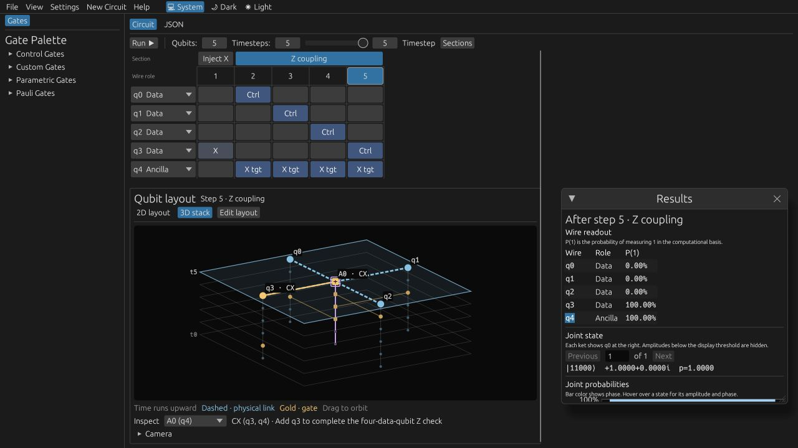
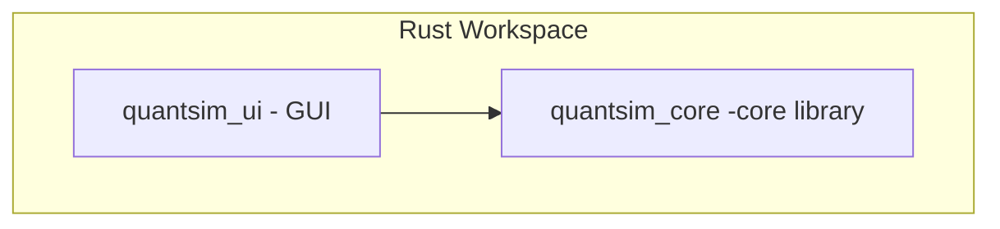
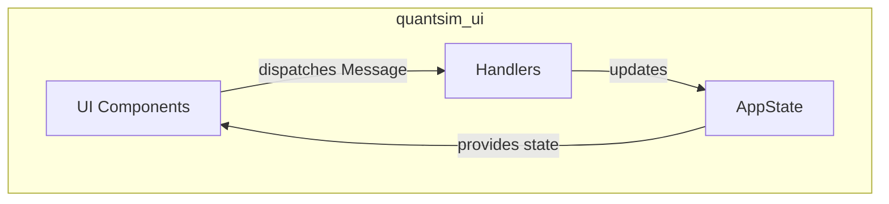
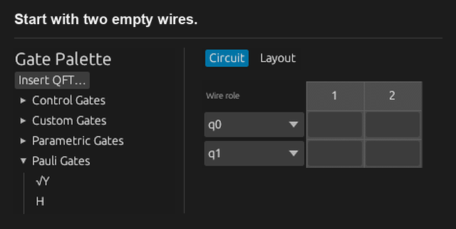

# Quantum Algorithm Simulator

[](https://benschneider.github.io/quantum_algorithm_simulator/)
[](COPYRIGHT.md)


[](https://www.conventionalcommits.org/en/v1.0.0/)

Build a circuit gate by gate, place its qubits on a 2D map, and follow each wire through time in a rotatable 3D stack.

<!-- CI badge (enable after adding .github/workflows/ci.yml):
[](https://github.com/benschneider/quantum_algorithm_simulator/actions)
-->

## Quick Links

- ▶️ **Live demo**: https://benschneider.github.io/quantum_algorithm_simulator/
- [How many qubits can I simulate, and with what accuracy?](docs/benchmarks/README.md#what-the-qubit-counts-mean)
- [What’s new in 0.4.0 and earlier release notes](RELEASES.md)
- 📄 **License**: [MIT OR Apache-2.0](COPYRIGHT.md)
- 🧭 **Roadmap & tutorials**: see the in-app **Tutorial** (Help → Tutorial)

### Publishing the web demo

With **Settings → Pages → Build and deployment → Source** set to **GitHub Actions**, each push to `main` builds the simulator from that commit and deploys it. You can also run **Build and publish web simulator** manually on `main`. [GitHub Pages publishing settings](https://docs.github.com/en/pages/getting-started-with-github-pages/configuring-a-publishing-source-for-your-github-pages-site)

If Pages is set to publish from **main /docs**, run `./deploy-web.sh` and commit the updated `docs/` files alongside the source before pushing. The script uses Trunk 0.21.14, Python 3 and the `wasm32-unknown-unknown` Rust target. New releases give the JavaScript and WebAssembly content-hashed filenames so browsers request the matching pair on reload.

# Introduction to `quantsim`

Try **File → Load Template → plaquette z check**. Four data qubits surround one ancilla, A0 (wire q4). In **2D layout**, select A0 to highlight its four neighbors. Step 1 flips q3. When will the ancilla first read 1?

Switch to **3D stack** below the grid and follow A0 upward. Select its site on layer 4, then on layer 5. **Results** shows q4’s probability of reading 1 change from 0% to 100% when the last CNOT couples q3 to q4. The dashed links show physical neighbors. The gold marks show which gates ran.



## Table of Contents

*   [Introduction to `quantsim`](#introduction-to-quantsim)
*   [High-Level Architecture](#high-level-architecture)
    *   [Project Structure](#project-structure)
    *   [Core Library: `quantsim_core`](#core-library-quantsim_core)
        *   [Key Components](#key-components)
        *   [Design Principles](#design-principles)
    *   [GUI Application: `quantsim_ui`](#gui-application-quantsim_ui)
        *   [Key Components](#key-components-1)
        *   [Unidirectional Data Flow](#unidirectional-data-flow)
    *   [Core UI Components](#core-ui-components)
    *   [Application Layout](#application-layout)
    *   [User Interaction Flow](#user-interaction-flow)
*   [Core Concepts](#core-concepts)
    *   [Dual-Component Architecture](#dual-component-architecture)
    *   [Model-View-Update (MVU) Architectural Pattern](#model-view-update-mvu-architectural-pattern)
    *   [Centralized and Modular State Management](#centralized-and-modular-state-management)
    *   [Key Features and Capabilities](#key-features-and-capabilities)
*   [How to Use `quantsim`](#how-to-use-quantsim)
    *   [Defining a Quantum Circuit](#defining-a-quantum-circuit)
        *   [Method 1: Using the Gate Palette and Circuit Grid](#method-1-using-the-gate-palette-and-circuit-grid)
        *   [Method 2: Using the JSON Editor](#method-2-using-the-json-editor)
        *   [Example: Bell State Circuit (from Template)](#example-bell-state-circuit-from-template)
    *   [Simulating a Quantum Circuit](#simulating-a-quantum-circuit)
        *   [Wide circuits and RAM estimates](#wide-circuits-and-ram-estimates)
        *   [Sycamore benchmark on 16 qubits](#sycamore-benchmark-on-16-qubits)
        *   [Results View](#results-view)
        *   [Time Scrubber](#time-scrubber)
    *   [Loading and Saving Circuits](#loading-and-saving-circuits)
        *   [Available Templates](#available-templates)
    *   [Initial State Setup and Gate Editor](#initial-state-setup-and-gate-editor)
        *   [Initial State Editor](#initial-state-editor)
        *   [Gate Editor with Bloch Spheres](#gate-editor-with-bloch-spheres)
    *   [Supported Gates and Information Panels](#supported-gates-and-information-panels)
    *   [In-App Tutorials](#in-app-tutorials)
*   [Potential Future Directions](#potential-future-directions)


---

## High-Level Architecture

This section provides a high-level overview of the `quantsim` project's architecture. It is intended for new developers to quickly understand the project's structure, components, and design principles.

### Project Structure

`quantsim` is a Rust workspace composed of two main crates:

*   **`quantsim_core`**: A pure Rust library that provides the core quantum circuit simulation engine. It has no dependencies on UI frameworks, making it portable and reusable.
*   **`quantsim_ui`**: A native GUI application built with the `egui` framework. It provides a user-friendly interface for building and simulating quantum circuits.

This separation of concerns allows the simulation engine to be developed and tested independently of the user interface.



### Core Library: `quantsim_core`

The `quantsim_core` library is the heart of the project. It is responsible for representing and simulating quantum circuits. Its architecture is designed to be modular and extensible.

#### Key Components

*   **`src/core/circuit.rs`**: Defines the quantum circuit data structure, which represents the sequence of quantum gates to be applied.
*   **`src/core/engine.rs`**: Implements the simulation engine that applies the gates to the quantum state.
*   **`src/core/gates.rs`**: Defines the various quantum gates that can be used in a circuit.
*   **`src/core/types.rs`**: Contains the fundamental data types used throughout the simulation, such as the representation of quantum states.

#### Design Principles

*   **Pure Rust Core**: The simulation engine is implemented in pure Rust with no dependencies on UI frameworks, making it portable and easy to integrate into other projects.
*   **Programmatic Gate Definitions**: All standard quantum gates are defined programmatically within the `GateRegistry`. This ensures that the core gates are always available and correctly implemented without relying on external files.
*   **Extensible Gate Model**: The `GateRegistry` supports multiple kinds of gates, making it easy to extend:
    *   **Unitary Gates**: Gates like H, X, and CNOT whose unitary matrices are defined as constants or generated by a function.
    *   **EigenGates**: A special trait for gates that can be raised to a power (e.g., `X^t`). This is used to implement rotational gates like `Rx`, `Ry`, and `Rz` efficiently and elegantly.
*   **Discrete Timestep Execution**: A quantum circuit is modeled as a sequence of timesteps, where each timestep contains a set of operations that are guaranteed by the validation logic to be on disjoint sets of qubits.
*   **Introspection API**: The simulation `run` method provides options to capture detailed, per-timestep snapshots of the full state vector and probabilities, not just the final result.
*   **Parallelism with Rayon**: The simulation engine uses the `rayon` crate to parallelize computationally intensive tasks:
    1.  **Gate Application**: The update of the state vector for each individual gate is parallelized.
    2.  **Measurement Sampling**: When running unseeded simulations with a large number of shots, the measurement outcomes are generated in parallel. (Seeded runs remain sequential to guarantee reproducibility).

### GUI Application: `quantsim_ui`

The `quantsim_ui` application provides a graphical user interface for interacting with the `quantsim_core` simulation engine. It is built using the `egui` framework and follows a Model-View-Update (MVU) architectural pattern.

#### Key Components

*   **`AppState` (`quantsim_ui/src/state/app_state.rs`)**: This struct is the single source of truth for the application's state. It contains all the data needed to render the UI, including the current circuit, simulation results, and UI-specific state.
*   **`Message` (`quantsim_ui/src/messages.rs`)**: This enum defines all the possible actions a user can take in the application. When a user interacts with the UI, a `Message` is dispatched.
*   **Handlers (`quantsim_ui/src/handlers/`)**: The `handlers` module contains the business logic of the application. It receives `Message`s and updates the `AppState` accordingly.
*   **UI Components (`quantsim_ui/src/components/` and `quantsim_ui/src/ui/`)**: The UI is built from a set of reusable components. These components are responsible for rendering the UI based on the `AppState` and dispatching `Message`s in response to user input.

### Unidirectional Data Flow

The `quantsim_ui` application follows a unidirectional data flow, which makes the application's logic easy to understand and debug.



This architecture ensures that all state changes are centralized and predictable, which is crucial for building a robust and maintainable application.

### Core UI Components

The application is composed of several distinct, interactive panels, each serving a specific pedagogical purpose. The rendering logic for each component is encapsulated within the `components` module.

*   **Gate Palette (`components::gate_palette`)**:
    *   **Purpose**: Allows users to select quantum gates to place on the circuit.
    *   **Interaction**: Gates are organized into categories. Clicking a gate selects it for placement.

*   **Circuit Grid (`components::circuit_grid`)**:
    *   **Purpose**: The main interactive area where users build a quantum circuit.
    *   **Layout**: A grid where rows represent qubits and columns represent discrete time steps.
    *   **Interaction**:
        *   Clicking an empty grid cell places the currently selected gate.
        *   Clicking a gate opens the gate editor.
        *   Right-clicking a gate removes it.

*   **Results Panel (`components::results_panel`)**:
    *   **Purpose**: Displays the results of the quantum simulation.
    *   **Contents**:
        *   **Wire readout** shows each wire’s probability of measuring 1 at the selected step.
        *   **Amplitude waveform** and **Overview** show the complex amplitudes in a selected range and the probability distribution across the register. The joint readout lists populated states through 21 wires and sampled outcomes on wider runs.

*   **Top Panel (`ui::top_panel`)**:
    *   **Purpose**: Provides application-level controls.
    *   **Interaction**:
        *   **File → Load Template** opens bundled examples. Use the **JSON** tab to import or export a circuit.
        *   A "Run" button to trigger the simulation.
        *   Controls for changing the number of qubits and timesteps.

### Application Layout

The layout uses `egui`'s panel system to create a clear, organized workspace.

*   **Top Panel**: Contains the main menu bar and circuit controls.
*   **Left Panel**: Contains the `Gate Palette`.
*   **Central panel** holds the circuit grid, a **Layout** tab for inspecting the chip at full width, and the **JSON** tab for importing and exporting circuits.
*   **Results** shows wire probabilities after the selected step. The joint readout shows amplitudes for small circuits and sampled outcomes for wide circuits. On smaller screens it opens below the circuit.

### User Interaction Flow

The primary user workflow is as follows:

1.  **Select a Gate**: The user clicks a gate in the **Gate Palette**.
2.  **Place the Gate**: The user clicks an empty slot in the **Circuit Grid**.
3.  **Run Simulation**: The user clicks the "Run ▶" button in the **Top Panel**.
4.  **View Results**: The user views the results in the **Results Panel**.

---

## Core Concepts

This section provides a summary of the core concepts and architectural principles of the `quantsim` project.

### Dual-Component Architecture

The `quantsim` project is built on a clear separation of concerns, divided into two primary components:

*   **`quantsim_core`**: The backend simulation engine, written in Rust. It contains all the fundamental logic for representing quantum circuits, defining quantum gates, and executing simulations. This component is designed to be completely independent of any user interface.
*   **`quantsim_ui`**: A graphical user interface (GUI) built using the `egui` library. It provides a user-friendly, interactive environment for building circuits, running simulations, and visualizing results. It acts as a frontend that consumes the `quantsim_core` library.

This modular design allows for flexibility, such as creating alternative interfaces (e.g., a command-line tool) or integrating the core simulator into other projects.

---

### Model-View-Update (MVU) Architectural Pattern

The `quantsim_ui` application is architected around the **Model-View-Update (MVU)** pattern, which ensures a predictable, unidirectional data flow.

*   **Model (State):** The entire state of the application is held in a central `AppState` struct. This struct acts as the single source of truth, containing everything from the circuit's structure to the UI's transient state (e.g., which tab is open).
*   **View (UI Components):** The UI is composed of various components (e.g., the circuit grid, the gate palette) that are responsible for rendering the current `AppState`. They do not modify the state directly.
*   **Update (Message Handling):** When a user interacts with the UI, a `Message` is generated. These messages are collected and processed in a central `handle_message` function, which is the *only* place where the `AppState` is allowed to be modified.

This pattern makes the application easier to debug and reason about, as state changes are explicit and centralized.

---

### Centralized and Modular State Management

The application's state is managed in a structured and centralized way:

*   **`AppState`:** The root of the state tree, aggregating all other state modules.
*   **Sub-states:** The `AppState` is composed of more specific state structs, each responsible for a different domain:
    *   `CircuitState`: Manages the quantum circuit data (qubits, gates, etc.).
    *   `UIState`: Holds UI-specific data, like selected items or window visibility.
    *   `SimulationState`: Stores the results from the simulation engine.
    *   `InitialStateEditorState`: Manages the state for the custom initial state editor.

This modular approach keeps related data organized and prevents the main state object from becoming overly complex.

---

### Key Features and Capabilities

The `quantsim` simulator supports a rich set of features designed for flexibility and ease of use:

*   **User-defined gates** accept a 2×2 unitary matrix in the Custom gate editor.
*   **State Persistence via JSON:** Circuits can be saved, loaded, and shared easily through a built-in JSON editor, which allows for direct viewing and modification of the circuit's data structure.
*   **Custom input states** can be entered as amplitudes through 21 wires. Wider circuits support per-wire preparations and editable preparation gates.
*   **Interactive Visualizations:** Features like the Bloch sphere visualization provide immediate feedback on the effect of single-qubit gates.

---

## How to Use `quantsim`

This section provides a basic overview of how to define and simulate quantum circuits using the `quantsim` EGUI application.

> This app runs in your browser via **WebAssembly (WASM)**. Performance depends on your device and browser. For best results, use a recent Chromium- or Firefox-based browser on desktop.

### Defining a Quantum Circuit

Quantum circuits in `quantsim` are defined visually by selecting gates from a palette and clicking on the circuit grid, or by directly editing their JSON representation.

#### Method 1: Using the Gate Palette and Circuit Grid



1.  Open **Gates** beside the circuit. On narrow screens, use the **Gates** menu next to **Circuit**.
2.  **Select a Gate**: Click on a gate in the palette to select it. The selected gate will be highlighted.
3.  **Place the Gate**: Click on an empty cell in the central circuit grid to place the selected gate.
    *   Place gates on specific qubits and at desired time steps.
    *   For CNOT, click the control wire first and the target wire second in the same column. Click either end of a placed CNOT to inspect or swap its control and target.
    *   To deselect a gate, click on it again in the palette, or click on an empty area of the circuit grid.
    *   The circuit grid allows you to visually construct your quantum circuit step-by-step.

Choose **Insert QFT…** in the Gate Palette to add a forward Fourier transform to your own circuit. Select the first wire, the number of consecutive wires, and the step after which to insert it. Use step 0 to insert at the beginning. Later gates move to the right. The **QFT** section contains ordinary editable gates and acts on the input you have already prepared.

Click a wire label at the left of the grid to annotate it as **Data** or **Ancilla**. Select **Unlabeled** to clear the role. Circuit JSON saves these annotations in `qubit_roles`, starting at q0.

**Qubit layout** below the circuit shows where the wires sit and which gates act at the selected timestep. Select a site to highlight its neighbors. Open **Edit layout** to choose **Line**, **Grid** or **Ring**, or enter your own site coordinates and choose which pairs to link. The four repetition-code templates place each parity ancilla between the two data qubits it checks.

The **2D layout** fits the chip to the available space. Use **+** for a closer look and **Fit** to see the whole chip again. Site colors show **P(1)**, the probability of measuring 1 on that wire at the selected step. Blue marks 0%, teal marks 50%, and coral marks 100%. Hover over a site for its percentage. In the 3D stack the same colors apply to the selected time layer.

Switch from **2D layout** to **3D stack** to follow a wire through time. Each layer is a timestep. Vertical trails join the same wire across layers, the selected layer shows the layout's physical links, and the gate markers show which wires interact at each step. Drag to orbit or use the view sliders. Select a site to inspect its wire at that step in **Results**. In **plaquette z check**, follow the central q4 through steps 2–5 to see its four CNOTs, one with each surrounding data wire.

Brackets on the time axis show the first and last step of each named section. Selecting a layer highlights its section. On a crowded timeline, the axis shows labels around the selected step. Hover over a label or bracket to read its full name and range.

A custom arrangement can be shared in the circuit's `layout` field. Put one integer `[x, y]` position per wire in q0, q1, … order. Each link is a pair of wire indices and connects them in both directions. Paste this three-site example into the **JSON** tab and select **Apply Changes** to see an L with q0 at the corner.

```json
{
  "num_qubits": 3,
  "layout": {
    "positions": [[0, 1], [1, 1], [0, 0]],
    "links": [[0, 1], [0, 2]]
  },
  "steps": [[]]
}
```

Circuits that omit `layout` display the wires in index order with no links. The simulator executes every gate on its specified wires, including gates between unlinked sites.

#### Method 2: Using the JSON Editor

For users familiar with the circuit JSON format, or for loading pre-defined circuits, you can use the integrated JSON editor:

1.  **Switch to JSON View**: In the central panel, select the "JSON" tab.
2.  **Edit JSON**: You can directly type or paste your circuit definition in JSON format here.
3.  Choose **Apply Changes** to load the edited circuit and layout. Open **JSON** again after a visual edit to see the updated definition.

#### Example: Bell State Circuit (from Template)

Open **File → Load Template → bell** for the annotated circuit. This minimal JSON uses the same gates.

```json
{
  "num_qubits": 2,
  "initial_preps": [null, null],
  "steps": [
    [
      {
        "id": "H",
        "qubits": [0]
      }
    ],
    [
      {
        "id": "CX",
        "qubits": [0, 1]
      }
    ]
  ]
}
```

This JSON defines a 2-qubit circuit. The first step applies a Hadamard gate to qubit 0. The second step applies a Controlled-NOT gate with qubit 0 as the control and qubit 1 as the target.


### Simulating a Quantum Circuit

Choose **Run ▶** above the circuit grid to open **Results** at the final step. To inspect an intermediate state, click its numbered column. On narrow screens, Results opens below the circuit.

#### Wide circuits and RAM estimates

The editor uses a dense state vector through 21 wires. For 22 or more it tries a stabilizer tableau, then independent single-wire states, then groups of entangled wires. This is why a 1,024-wire circuit made of four-wire groups can fit while a much smaller connected circuit can exhaust memory. Each additional wire in a dense group doubles that group’s amplitude storage. The simulator can split individual wires off again when it detects separability.

Click **Est. peak RAM** beside **Run** to set **Warn above** in MiB. The default is 64 MiB in the browser and 128 MiB on desktop. The estimate covers the main simulation buffers for a full run and can be conservative when groups later split. Total browser or desktop process memory can be higher. **Run** stays available above the warning level.

A Chrome check on November 23, 2026 recorded these pre-run estimates for three 30-wire circuits. A retained readout from an earlier step can also affect the estimate for the next run.

| Circuit | Estimated peak RAM | Browser check |
| --- | ---: | --- |
| Hadamard on q0 followed by a chain of 29 CNOTs | ≤197 KiB | Read the estimate at step 0 |
| Controlled quarter-phase gates joining 16 wires | ≤3 MiB | Set the warning to 1 MiB and completed all 16 steps with one click |
| Controlled quarter-phase gates joining all 30 wires | ≤32.1 GiB | Previewed at step 0 only |

To try the wide Bell pair, choose **File → Load Template → bell 256**, then **Run**.

In Chrome, q0 and q255 each read 50%. Of 1,024 shots, 515 were all zeros and 509 had only q0 and q255 set. All 254 intervening wires stayed at zero. For a step-by-step example, the 50-wire QFT template shows the Fourier waveform, and the 53-site Sycamore template lights up the active couplers on its 2×4 patch. That patch's readouts match a dense eight-wire reference at every step.

#### Sycamore benchmark on 16 qubits

A separate native experiment compared a matrix product state (MPS) with a double-precision dense simulation on a 2×8 Sycamore patch. Both ran the same 16 rounds with random single-qubit gates (seed 53) and alternating couplers. The dense state used 1 MiB for its 65,536 amplitudes. By round 7, the uncapped MPS reached bond dimension 256 and used 2.13 MiB for its tensors. Its amplitudes agreed with dense to within 5.6 × 10⁻¹⁶ across the run.

Limiting the bond dimension saved tensor storage at the cost of accuracy. The table gives **round-16** results. Fidelity is the squared overlap with the dense state. The two error columns average absolute differences across all 16 wires and all 22 neighboring pairs. Tensor storage excludes temporary workspace.

| Bond cap | Tensor storage | Fidelity | Error in probability of 1 | Error in connected Z correlation |
| ---: | ---: | ---: | ---: | ---: |
| 16 | 72.5 KiB | 0.77% | 2.00 percentage points | 0.02289 |
| 32 | 200.5 KiB | 3.24% | 1.11 percentage points | 0.01151 |
| 64 | 648.5 KiB | 17.11% | 0.42 percentage points | 0.00681 |

Local readouts could look close even at low fidelity because the dense wire probabilities approached 50% and neighboring correlations approached zero. Earlier rounds showed larger individual differences. At round 7, cap 64 gave 73.12% on wire 7, where dense gave 62.50%. The browser's RAM warning estimates its own dense, stabilizer, product, or grouped simulation.

On the eight-round version of this patch, profiling each cut and giving the middle cut more capacity raised whole-state fidelity from 0.299 to 0.675. The native example can replay the selected caps without repeating calibration. The 256-qubit eight-round ladder also recovered its input to within 10⁻¹² of unit probability at bond cap 256. [MPS policy comparison](docs/benchmarks/README.md#paired-gates-and-a-tensor-budget) · [256-qubit echo and memory cost](docs/benchmarks/README.md#recovering-the-256-qubit-input)

For your current circuit, open **Est. peak RAM → Estimate MPS cap**. On a compatible two-row ladder, it reads the gate schedule and reports a sufficient bond cap and a bound on retained tensor storage. Factorization needs additional workspace. The editor’s **Run** button still uses the dense or compact methods described above.

Open **File → Load Template → MPS ladder echo 256** or **Settings → MPS ladder experiment**. **Auto** computes the cap from the built-in 256-qubit forward circuit. **Target return** chooses among measured caps for this seed and depth, and **Manual** lets you try one directly. The desktop **Run echo** button applies the selected cap locally. Use `cargo run --release --locked -p quantsim_ui` for a native release build. The web build offers cap inference and the recorded curve. [Curve, measurements and reproduction](docs/benchmarks/README.md#choosing-a-bond-cap)

#### Results View

The "Results" window displays the outcome of your simulation:

*   **Wire readout** shows each wire's role and its probability of reading 1 in the computational basis.
*   **Amplitude waveform** plots the real and imaginary parts at up to 64 basis indices. The axis gives the actual amplitude scale. The automatic window follows the first occupied index and the lowest varying bit as the circuit evolves. Small registers show every index. Use **Range** to inspect another part of a large register. All simulators use the first occupied index as a positive real phase reference for the graph.
*   Choose **Overview** to see how probability is distributed across the whole register at the selected step. It groups adjacent basis indices by their leading bits into up to 32 bars. Select a bar to read its range and probability. Dense runs sum the simulated probabilities directly. Wide runs count all 1,024 joint samples, including outcomes outside the 16 displayed rows.
*   For **1–21 wires**, **Joint state** shows populated basis states and their amplitudes. **Joint probabilities** uses the same 0–100% scale at every step and on every page. Hover over a bar to read its amplitude and phase.
*   For **22 or more wires**, **Joint samples** shows counts from 1,024 simulated measurements at the selected step. It lists up to 16 observed outcomes in descending frequency and groups the remaining counts. The rightmost bit is q0. Wire probabilities are calculated directly from the state.
*   When the grouped simulator is active, select a wire in the layout inspector to see which wires are stored together at that step.


#### Time Scrubber

The **Timesteps** field accepts 1 to 1,000 steps. The scrubber covers the full length of the loaded circuit.

Use **Next step** and **Previous step** to follow the circuit at your own pace. **Play** advances one step every two seconds, including at section boundaries. Choose **Pause** to study a step for longer. The **Timestep** slider and numbered columns jump directly to a step. Step 0 shows the initial state. Clicking a section label jumps to its last step. You can revisit any step without collapsing the simulated state.

To annotate a circuit, open **Sections** beside the slider, choose **New section**, and enter a label and its first and last steps. Add an optional description of what to look for, then save. The label spans those columns, and Results shows the description beneath the step title. Open **Sections** again to edit or delete it. Wire roles and sections travel with the circuit JSON.


### Loading and Saving Circuits

Open **File → Load Template** to choose a bundled circuit. To import your own circuit, paste its JSON into the **JSON** tab and select **Apply Changes**. To save an editable copy, open the **JSON** tab, choose **Copy to Clipboard**, and paste the result into a JSON file.

#### Available Templates

For a step-by-step reading of the examples, open **Help → Tutorial → Template guide**. [Read the template guide](crates/quantsim_ui/assets/docs/tutorials/template_guide.md).

*   **Bell** and **GHZ** show how a controlled gate turns one wire's superposition into correlations between two or three data wires.
*   **ghz 50** extends a Bell pair to 50 wires in seven steps. Compare steps 6 and 7 to see q49 join the correlated group.
*   **bell 256** entangles q0 with q255 in two steps. Each endpoint reads 50%, and they agree in every joint shot.
*   **MPS ladder echo 256** opens the benchmark’s 2×128 ladder in its own window. Compare the measured chance of returning to all zeros at bond caps 128 and 256. The desktop app can also run the echo at the selected cap.
*   **phase echo 512** rotates and reverses the phase on 512 independent wires. Remove the inverse rotation on q0 at step 3 and run again. Only q0 changes, with a 14.64% chance of reading 1.
*   **grouped blocks 1024** prepares 256 entangled four-wire blocks. The final CNOT connects the first two blocks. Remove it to see the largest group shrink from eight wires to four while each wire still reads 1 half the time.
*   **sycamore echo 53** spreads a GHZ state from q23 across all 53 sites in seven layers of CNOTs. The Z gate on q33 at step 9 leaves all local probabilities at 50%. After reversing the CNOTs, the final Hadamard makes q23 read 1 with certainty. Remove that Z and run again to see q23 read 0. [Watch the 29-second demo](https://benschneider.github.io/quantum_algorithm_simulator/showcase/sycamore-echo-53.mp4) · [Looping GIF](https://benschneider.github.io/quantum_algorithm_simulator/showcase/sycamore-echo-53.gif)
*   **Bell test complex** uses two extra wires to select rotations of a Bell pair. Group the final rows by those setting bits to see how often the two data wires agree.
*   **Deutsch algorithm** uses a single query to a balanced oracle. The final Hadamard turns a phase difference into a definite 1 on q0.
*   **Grover** marks `11` among four states. **Grover algorithm** marks `100` among eight and lets you compare two rounds of amplification.
*   **QFT** and **QFT4** apply the forward Fourier transform to `01` and `1011`. The output probabilities are uniform. The complex amplitudes show how the phases advance.
*   **qft 50** starts with an X gate on q45 to prepare a single input spike. Select **Input** to inspect it, then **Run** to see the Fourier transform. Its imaginary amplitude follows a sine wave with 32 basis indices per period. The template guide shows how to turn an edited phase into a measurable change on q0.
*   **fourier wave 50** builds one Fourier mode in ten labeled steps. The first five spread the amplitude over all 50 qubits. The next five change only the phases. Watch the imaginary amplitude resolve into a sine wave while the measurement probabilities stay fixed.
*   **Quantum teleportation** transfers a prepared state from q0 to q2 using a shared Bell pair and two coherently controlled corrections. Inspect the receiver before and after correction.
*   **Plaquette z check** uses one central ancilla to read the joint Z parity of four neighboring data qubits over four CNOT steps.
*   **sycamore 53** opens the 53-site chip in 3D. Drag to orbit, then choose **Next step** to follow the prepared 1 from q21 to q22, q23 and q33 on a 2×4 patch. Inspect q33 at steps 3 and 4 to see it split from a four-qubit group. [Watch the 3D walkthrough](https://benschneider.github.io/quantum_algorithm_simulator/showcase/sycamore-3d-walkthrough.mp4) · [Sycamore chip layout and gate](https://quantumai.google/hardware/datasheet/weber.pdf)
*   **Error correction bit flip** and **Error correction bit flip two faults** encode one logical qubit across q0–q2. The **Z coupling** section writes adjacent-pair parities into ancillas q3 and q4. Compare the syndrome at step 7 and the decoded output on q1 at step 13.
*   **Error correction phase flip** and **Error correction phase flip two faults** use the same five-wire layout. The **X coupling** section surrounds ancilla-controlled CNOTs with Hadamards on the ancillas. Compare the syndrome at step 10 and the decoded output on q1 at step 17.

In each pair, a fault on q1 and faults on both q0 and q2 give the same syndrome, `11`. The correction recovers the original logical state in the single-fault example. The two-fault example shows the limit of the three-qubit repetition code.

Open the examples from **File → Load Template** and follow along under **Help → Tutorial → Error correction**. [Read the walkthrough](crates/quantsim_ui/assets/docs/tutorials/error_correction.md).

### Initial State Setup and Gate Editor

#### Initial State Editor

For up to 21 wires, open **Settings → Set Initial State...**, enter the real and imaginary amplitudes, and choose **Apply**. Their squared magnitudes must sum to one. **Reset to |0>** clears the custom vector.

For 22 or more wires, use `initial_preps` in the **JSON** tab. For example, `"initial_preps": ["Plus", "One"]` prepares q0 in |+⟩ and q1 in |1⟩. Omitted wires start at zero. Each entry can be `"Zero"`, `"One"`, `"Plus"` or `"Minus"`.

#### Gate Editor with Bloch Spheres

Open **Gates → Custom Gates → Edit** to enter a one-qubit unitary matrix. **Save** sets the palette matrix for future placements in this session. Each placed Custom gate carries its own matrix in the circuit JSON.

Click a placed gate to inspect its matrix. For single-qubit gates, the Bloch sphere shows how the gate transforms the indicated reference input.

### Supported Gates and Information Panels

`quantsim` supports a variety of common quantum gates.

*   **Gate Reference**: For a complete list of supported gates and their parameters, navigate to the "Help" menu, select "Info", and then choose the "Gate Reference" tab.
*   **About Panel**: The "About" tab in the "Help" menu provides application details.

### In-App Tutorials

Choose **Start tutorial** on the welcome screen or open **Help → Tutorial**. In **First circuit**, click **Load Bell example** and compare steps 1 and 2 in the live grid. The example button replaces the circuit just like **File → Load Template**.

Use **Next** and **Back** to follow the exercises, or choose a chapter from the dropdown. Closing the tutorial and reopening it from Help returns you to the same chapter for the rest of the session.
On narrower screens, the tutorial sits below the circuit and Results sits below the tutorial. Each can be scrolled independently.

---

## Potential Future Directions

Based on initial concepts and roadmap documents, `quantsim` has potential for future evolution in several areas:

### Gamification and Educational Enhancement
*   **Structured Tutorial Campaigns:** Guided learning paths with immediate feedback, covering quantum fundamentals to advanced algorithms.
*   **Sandbox Mode:** Open experimentation environment with features like circuit sharing and community integration.
*   **Competition Mode:** Algorithmic challenges with resource constraints.
*   **Code Mode:** Implementation of a quantum assembly language with bi-directional synchronization to the visual circuit builder.

### Advanced Quantum State Visualization
*   **Multi-Level Bloch Sphere Visualization:** More sophisticated 3D rendering and dynamic updates.
*   **Full Density Matrix Visualization:** Expert-level visualization for in-depth state analysis.

### Real-world Simulation Aspects
*   **Noise Models:** Introduction of realistic noise models to simulate imperfections in quantum computers.

---

## License

Licensed under either of

- Apache License, Version 2.0 ([LICENSE-APACHE](LICENSE-APACHE) or https://www.apache.org/licenses/LICENSE-2.0)
- MIT license ([LICENSE-MIT](LICENSE-MIT) or https://opensource.org/licenses/MIT)

at your option.

### Contribution

Unless you explicitly state otherwise, any contribution intentionally submitted
for inclusion in the work by you, as defined in the Apache-2.0 license, shall be
dual licensed as above, without any additional terms or conditions.
