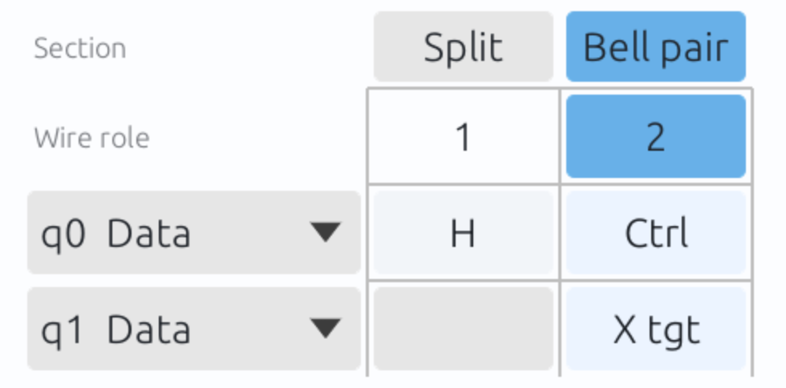

# Quantum Algorithm Simulator

How can two qubits each have a 50% chance of reading 1, yet agree every time you measure them? You can try that experiment in two steps. This simulator runs in your browser and lets you inspect a circuit after each step. [Open the simulator](https://benschneider.github.io/quantum_algorithm_simulator/)

## See it in action

Build a Bell pair with two gates, then click step 2 to see why the two qubits always agree when measured together.

- Follow a single 1 as it moves between neighboring qubits on the Sycamore chip. [Watch the 3D walkthrough (36 seconds)](https://benschneider.github.io/quantum_algorithm_simulator/showcase/sycamore-3d-walkthrough.mp4)
- See how changing the phase on one qubit affects the final reading on another. [Watch the 53-qubit echo (29 seconds)](https://benschneider.github.io/quantum_algorithm_simulator/showcase/sycamore-echo-53.mp4) · [Looping GIF](https://benschneider.github.io/quantum_algorithm_simulator/showcase/sycamore-echo-53.gif)

## Your first experiment

A **qubit** is a unit of quantum information. When you measure one here, you get a single bit, either 0 or 1. Its state before measurement tells you the chance of each answer. A **gate** is an operation that changes the state. A **circuit** is a sequence of gates.

Open **File → Load Template → Entanglement → bell**. Each horizontal row is one qubit, labeled q0 or q1. Read the numbered columns from left to right. Both qubits start at 0.

1. Click **1**. The **H** (Hadamard) gate puts q0 into a *superposition*. Measuring q0 now gives 0 or 1 with equal probability. Nothing has acted on q1 yet, so it still reads 0 every time.
2. Click **2**. **Ctrl** and **X tgt** are the two ends of one gate, called controlled-X (CX). It leaves q1 alone where q0 is 0 and flips q1 where q0 is 1. In **Results**, scroll to **Joint state**. What happened to the chance of seeing the two qubits disagree?

| When you measure | Possible results, written as q1 q0 |
| --- | --- |
| Before the gates | `00` every time |
| After H | `00` or `01`, each 50% |
| After CX | `00` or `11`, each 50% |

At the last step, either qubit on its own looks random. Read them together and they always match. The gates have prepared a **Bell pair**, an entangled state. You need a shared quantum state to fully describe the pair. To try a change, right-click the H gate to remove it and press **Run**. Can you explain why the only result is now `00`?

## Where phase shows up

Light waves traveling along two paths can reinforce or cancel each other when they meet. Quantum **amplitudes** can do the same. Each path contributes an amplitude with a size and a phase. The relative phase determines whether the contributions reinforce or cancel. Squaring the size of the combined amplitude gives the probability of that outcome.

Open **File → Load Template → Qubit layouts → Ring interferometer (8 qubits)**. At step 7 there is a single 1 to find. It is equally likely to be at q4 or q5. At step 8 a **Z** gate changes the phase on one path, and both probabilities still read 50%. Press **Run** to recombine the paths. The 1 arrives at q4 every time. Now switch to **Circuit**, right-click the Z on q4 at step 8, and run again. The 1 arrives at q5. That change of exit is how you can see the effect of phase.

## Results view

- **Wire readout** answers a question about one qubit. **P(1)** is its chance of giving 1 if you measure it at the selected step.
- **Joint state** answers a question about all the qubits together. Each string is one possible result, with q0 on the right. On wider circuits, **Joint samples** shows the results of 1,024 simulated measurements. Each measurement is called a *shot*.
- **Overview** shows how much probability falls in each range of bit strings. **Amplitude waveform** shows the real and imaginary parts of the amplitudes. Together these two traces let you see phase changes that leave the probabilities unchanged.

Click a numbered column to revisit a step, choose **Play** to advance every two seconds, or open **Layout → 3D stack** to see the steps stacked above one another. [See a circuit in the 3D results view](docs/plaquette-stack.jpg)

## Wide circuits and RAM estimates

If you measure all three qubits in a circuit, you get three bits. Eight different strings are possible, from `000` to `111`. Each extra qubit doubles the number of possible strings. The circuit determines which ones occur and how likely they are.

Try **Scale experiments → bell 256** under **File → Load Template**. Only the first and last qubits form a Bell pair. The other 254 stay at zero. The simulator can store that pattern compactly. A much smaller circuit can need more memory if its gates create a state that requires a long list of amplitudes to describe.

**Est. peak RAM** beside **Run** estimates the memory the simulation will use. Click it to set your own warning threshold. You can still run above it. [What the qubit counts mean, with measured examples](docs/benchmarks/README.md#what-the-qubit-counts-mean)

## Explore further

- **Try another experiment.** Open **Help → Tutorial** for guided exercises. The template guide covers Fourier waves, teleportation, and error correction, with steps to inspect and changes to try. [Template guide](crates/quantsim_ui/assets/docs/tutorials/template_guide.md)
- **Build your own.** Select a gate from **Gates**, then click an empty cell in **Circuit**. For a CX, click the control wire first and the target wire second in the same column. The **JSON** tab lets you copy a circuit or paste one to share. [Editor guide](crates/quantsim_ui/README.md#usage)
- **Measure entanglement.** In **Results → Entanglement cut**, split the wires into two groups to see how strongly the groups are entangled. Try the Bell pair first, then follow the same measurement on the 16-qubit Sycamore patch. [Cut inspector walkthrough and results](crates/quantsim_ui/assets/docs/tutorials/template_guide.md#measure-entanglement-across-a-cut)
- **Run locally or use Rust.** The desktop app runs offline. Developers can also use the simulation library directly. [Desktop installation](crates/quantsim/README.md#quick-start) · [Rust library](crates/quantsim_core/README.md) · [Web build](crates/quantsim_ui/README.md#building-for-production) · [Release notes](RELEASES.md)

## Citation

If you use this simulator in research, cite the version you ran. On GitHub, select
**Cite this repository** to copy the citation. [Citation metadata](CITATION.cff)

For benchmark results, also report which simulation backend you used and any
approximation settings, such as the bond dimension cap for a matrix product state.

## License

Licensed under either of

- Apache License, Version 2.0 ([LICENSE-APACHE](LICENSE-APACHE) or https://www.apache.org/licenses/LICENSE-2.0)
- MIT license ([LICENSE-MIT](LICENSE-MIT) or https://opensource.org/licenses/MIT)

at your option.

### Contribution

Unless you explicitly state otherwise, any contribution intentionally submitted
for inclusion in the work by you, as defined in the Apache-2.0 license, shall be
dual licensed as above, without any additional terms or conditions.
