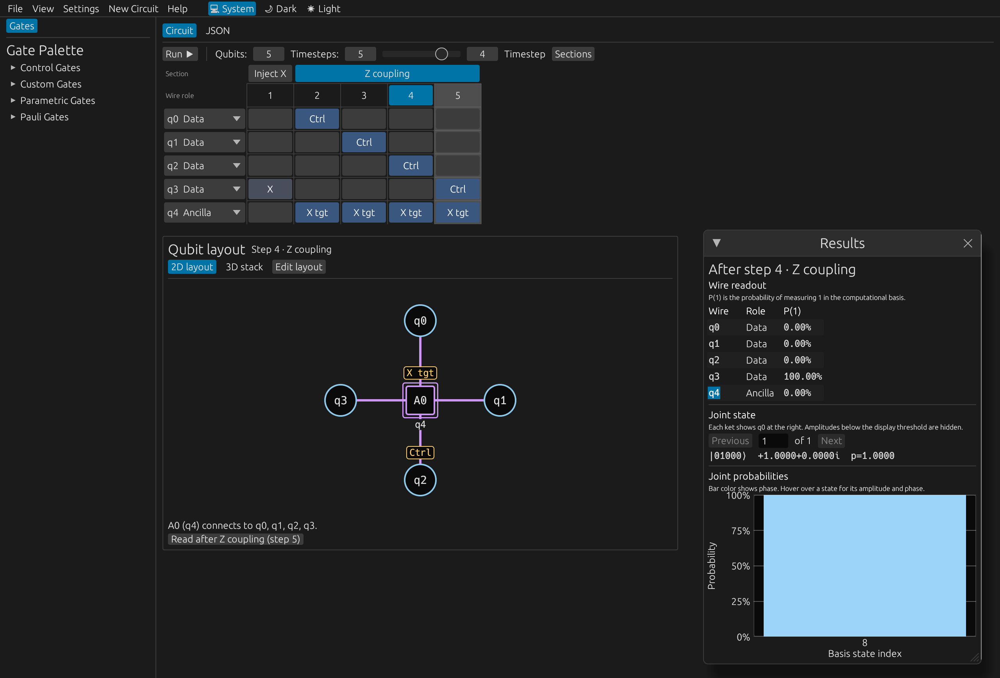
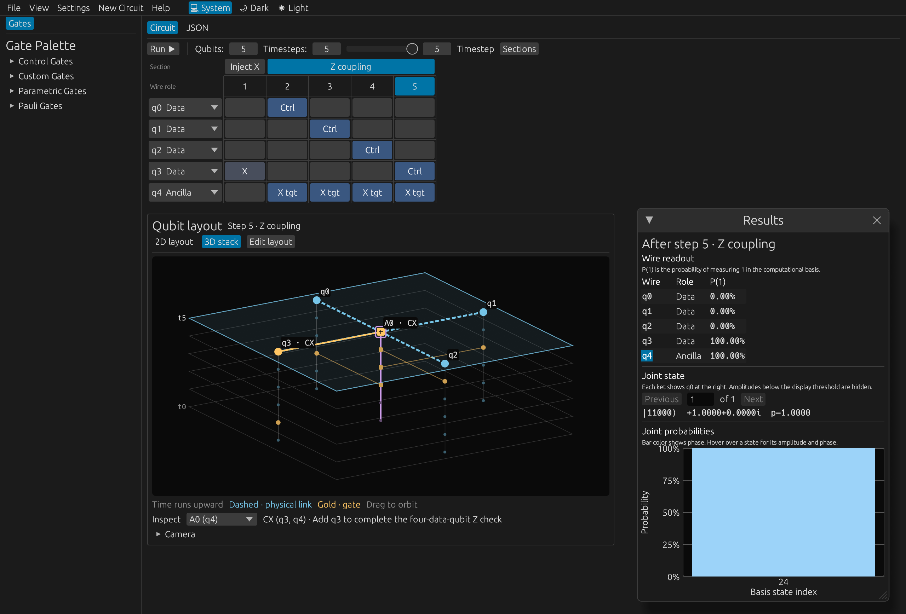
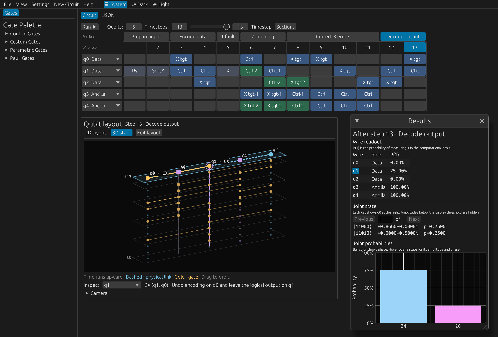
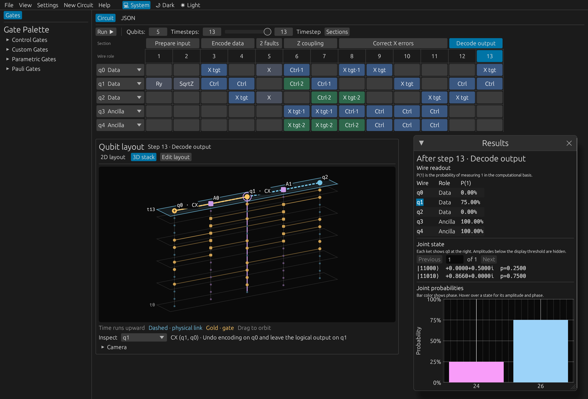

# Quantum Algorithm Simulator releases

## 0.3.0

Since 0.2.2, the simulator has gained two ways to explore the circuit you build on the gate grid. **2D layout** shows where the qubits sit and which sites are linked. **3D stack** places successive timesteps above that map. Rotate the stack and click a site to see the gate on that wire and its readout at that instant. [Open the simulator](https://benschneider.github.io/quantum_algorithm_simulator/)

### Follow a parity check through time

Open **File → Load Template → plaquette z check**. Four data qubits surround an ancilla, A0 (wire q4). The circuit flips q3 in step 1. Predict when A0 will first read 1.

1. In **2D layout**, click the central square, A0, to highlight the four neighbors it checks.
2. Switch to **3D stack**. Click A0 on layer 4, then layer 5. Its chance of reading 1 goes from 0% to 100% when the final CNOT couples q3 to q4. Dashed lines on the selected layer show physical links. Gold marks show the active gates.

| The five physical sites | The same sites through time |
| --- | --- |
|  |  |
| **Step 4.** A0 has checked q0, q1 and q2. Its chance of reading 1 is still 0%. | **Step 5.** The gold connection reaches q3. A0 now reads 1 with 100% probability. |

For your own circuit, choose **Edit layout** to start from a line, grid or ring, or enter your own coordinates and links. You can label wires as data or ancilla and give ranges of steps names such as *Encode data*. Layouts, roles and section names travel with the circuit JSON.

### Same syndrome, different outcome

Try **error correction bit flip**, then **error correction bit flip two faults**. Each template encodes one logical qubit across three data wires and uses two ancillas to record pairwise disagreements. A fault on the middle wire and faults on both outer wires produce the same ancilla readout, `11`, at step 7. The circuit therefore applies the same correction in both runs. Click **Decode output** to inspect q1 at step 13.

| One fault on q1 | Two faults on q0 and q2 |
| --- | --- |
|  |  |
| The correction restores the input. q1 reads 1 with 25% probability. | A logical flip remains. q1 reads 1 with 75% probability. |

The **error correction phase flip** pair lets you run the same comparison for phase faults. Inspect the two ancillas after **X coupling** at step 10, then q1 after **Decode output** at step 17.

### Faster simulation with less memory

Applying a multi-qubit gate to part of a larger circuit now updates small groups of amplitudes in place. The engine also hands the finished state to the results panel and reuses its probabilities when sampling shots.

| Native release benchmark on Apple Silicon | Before this change | 0.3.0 |
| --- | ---: | ---: |
| Time for four prepared gates on a dense 20-qubit state (CX, CZ, CCNOT and CXPow) | 110.85 ms | 86.29 ms |
| Peak live heap during a 20-qubit run with four Hadamards, without shots or snapshots | 20.0 MiB | 12.0 MiB |

The timings are medians of 16 samples per build after warm-up. The heap figures count live allocations during the run. With 1,024 seeded shots the same circuit also allocated 12 MiB less in total. The tested runs produced matching amplitudes, probabilities and seeded measurements. These figures compare native builds on the same machine. Browser timings will depend on the device.

### Circuit editing, tutorials and web delivery

- Load a second JSON circuit or template directly. Switching to a shorter circuit resets the selected step. An invalid replacement leaves the last working circuit and results available.
- Identify control and target wires on directional gates and swap their order. Placed custom gates retain their matrices, and controlled gates expose their editable parameters when reopened.
- Inspect the probability for each wire and the complex amplitudes of the joint state after any step. Probability charts keep the same 0–100% scale across runs and fit the horizontal axis when the displayed basis states change. The tutorial and results stack on smaller screens.
- Start the revised tutorial with a Bell pair, then follow the template guide through search, interference, teleportation or error correction. The Rust API examples and crate README snippets have also been updated and tested.
- Each push to `main` builds the WebAssembly simulator. The generated page, JavaScript and WebAssembly use matching asset hashes so a reload picks up the corresponding build.
