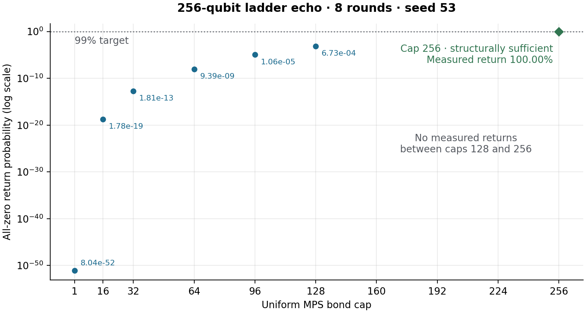

# Quantum Algorithm Simulator benchmark and technical audit

## What the qubit counts mean

Measuring a qubit gives one bit, either 0 or 1. With two qubits there are four possible results (`00`, `01`, `10`, `11`). A third qubit doubles that list to eight. To predict what happens after *any* gate, one approach is to keep a number called an **amplitude** for every result. Its size determines how likely that result is. Its phase lets different paths to the same result reinforce or cancel each other.

Try **File → Load Template → Entanglement → ghz**. When you run it, the three qubits give either `000` or `111`, each half the time. The same pattern extends to 256 qubits. They all read zero together or all read one together. The simulator can track that relationship and the phase between the two possibilities in very little memory. We tested this pattern through 1,024 qubits on a Mac with 32 GB of memory. [Explore the circuit templates](../../crates/quantsim_ui/assets/docs/tutorials/template_guide.md#find-a-correlation)

A different circuit on the same machine used a full table of amplitudes for just 24 qubits. Each extra qubit doubles the table. At 32 qubits, storing the amplitudes and their probabilities in that test would take 48 GiB. The browser editor uses the full table through 21 qubits and tries compact descriptions for wider circuits. How far you can go depends on the gates and the state they create. [Compare the measured circuits](#selected-results)

You can also ask how much accuracy a smaller description costs. Open **Settings → MPS ladder experiment**. A *matrix product state* (MPS) stores the state in linked pieces, one per column of the ladder. Imagine dividing the ladder between two columns. The **bond cap** limits how much detail the model can keep about correlations between everything to the left and everything to the right.

In the experiment, 256 qubits start at zero. The simulator applies a sequence of gates, then undoes them. How often does it recover all zeros with a smaller cap? The browser shows the recorded results, and the desktop app can repeat the experiment. [Compare return probabilities](#choosing-a-bond-cap)

[Raw benchmark data](benchmark.csv) · [Machine and build details](metadata.json) · [Correctness checks](correctness-probes.json) · [Release summary](release-summary.md)

## Reproduce

Run from the repository root with Rust and Python 3 on macOS or Linux. Plotting additionally requires Matplotlib (3.10.1 for the checked-in figures).

```sh
python3 docs/benchmarks/run.py --out target/benchmark-replay
python3 docs/benchmarks/plot.py --csv target/benchmark-replay/benchmark.csv --out target/benchmark-replay
```

The runner builds the core example in native Cargo release mode (`--locked`, `opt-level = 3`), runs a fixed serial matrix with three fresh measurement processes per case, and runs a fourth process for correctness. It sets `RAYON_NUM_THREADS=1`. Add `--offline` when dependencies are already cached, or `--workload qft` to run one family. Plotting supports repeated `--format png`, `--format svg` or `--format pdf` arguments. A run writes its own data, source patch, build information and SHA-256 hashes to the requested output directory.

The checked-in data came from an **Apple M1 Max** (10 cores, 32 GB unified memory, MacBookPro18,2), macOS 27.2.1 (26B131), with `rustc 1.99.1` (`58cf8f9c3`, aarch64-apple-darwin, LLVM 23.1.1) and Cargo 1.99.1. The base Git commit is `64b5c5a2a3ab54703013e5e999c51c3326d4a546`. The baseline includes working-tree changes to dense readout normalization and an experimental MPS chain. To reproduce the original dataset, start with a clean tree at that commit, copy the four Rust modules in `crates/quantsim_core/examples/audit_benchmark/` to the same paths, then apply `audited-source.patch` with `git apply`. The patch restores the original dense kernel, MPS chain, benchmark entry point and Python runner. All 36 input hashes were checked against this reconstruction. The commands above on the current checkout build the updated experiment. [Baseline patch](audited-source.patch) · [Original input hashes](metadata.json)

## What the backends implement

| Path | Implemented algorithm and scope | Literature relationship |
|---|---|---|
| Stabilizer tableau | [`Circuit::run_stabilizer_prefix` and `CliffordOperation::decode`](../../crates/quantsim_core/src/core/stabilizer.rs#L43) admit H, S, X, Y, Z and CX with per-wire preparations. [`StabilizerState::zero`, `h`, `s`, `cx`, `Pauli::multiply`](../../crates/quantsim_core/src/core/stabilizer/tableau.rs#L24) maintain $n$ stabilizer and $n$ destabilizer rows as variable-width BigUint X/Z masks with phase modulo four, using the convention $i^p X^x Z^z$. [`amplitude_view`, `echelon`, `amplitude_wide`, `sample_indices`](../../crates/quantsim_core/src/core/stabilizer/tableau/amplitudes.rs#L22) eliminate over GF(2), solve diagonal support constraints, and use X translations to reconstruct relative phases and sample uniform affine support. The amplitude view fixes a global phase. The tableau stores $O(n^2)$ bits in the worst case. | Direct Aaronson–Gottesman tableau representation and Clifford conjugation. The non-destructive amplitude index and sampling implementation are repository-specific. Dehaene–De Moor describes related affine support and phase structure. |
| Independent product | [`Wire::apply_single`, `ProductState::apply`, `amplitude_from_bits`](../../crates/quantsim_core/src/core/product_state.rs#L84) store two complex f64 amplitudes per wire. Single-wire matrices generally come from the f32 registry, are widened, and the output pair is normalized. SWAP reorders wires. Selected CX and controlled phase operations reduce by certified basis controls or an X-eigenstate target. Product amplitudes are products of local entries and joint samples use independent wire draws. State storage is $O(n)$. | Direct tensor-product evolution for a restricted admission set. Jozsa–Linden and Vidal provide related theory about restricted entanglement. |
| Dynamic groups | [`GroupedState::join`, `apply_phase`, `apply`](../../crates/quantsim_core/src/core/grouped.rs#L173) keep disjoint factors and form a Kronecker product of the operand factors when required. Single wires are inline. A width-$k$ grouped factor stores $2^k$ complex f64 entries. Ordinary built-in gates use f32 coefficients widened to f64 and normalize the whole factor. Fixed controls, phase kickback and SWAP relabeling can avoid merges. [`Factor::apply_matrix`](../../crates/quantsim_core/src/core/grouped.rs#L62) gathers fixed-arity local inputs on the stack and writes back in place. | Direct tensor-product factorization and local state-vector updates. Jozsa–Linden is related bounded-block theory. The implementation follows the circuit order and searches only singleton cuts. |
| Separability and splitting | [`Factor::split_singleton`](../../crates/quantsim_core/src/core/grouped/split.rs#L15) tests the rank of a $2\times 2^{k-1}$ wire-versus-rest unfolding. It chooses a largest-amplitude pivot, computes a complex row ratio and requires exact floating-point equality for every paired entry. [`split_singletons`](../../crates/quantsim_core/src/core/grouped/split.rs#L6) repeats a successful peel after eligible multi-wire operations. The search is restricted to singleton cuts and exact stored equality. One failed sweep can cost $O(k2^k)$ complex comparisons for a $k$-wire factor. [`Wire::basis_bit`, `x_minus`, `from_factor`](../../crates/quantsim_core/src/core/product_state.rs#L20) add an exact amplitude predicate and a gate-history certificate for control simplification. Numerically recovered factors start uncertified. | Direct rank-one pure-state separability criterion, equivalent in exact arithmetic to Schmidt rank one at that cut. The pivot test and split policy are local implementation choices. |
| Dense state vector | [`Circuit::run_prefix`, `prepare_and_validate_steps`, `execute_steps`](../../crates/quantsim_core/src/core/circuit.rs#L318) clone and prepare the authored gates, evolve one `DVector<Complex<f32>>`, and materialize final f32 probabilities. [`apply_sparse_gate`, `apply_one_qubit_gate`, `GateSubspace::transform`](../../crates/quantsim_core/src/core/engine.rs#L237) update disjoint stride pairs for one wire and gather–multiply–scatter fixed-spectator blocks for larger local gates. CSR coefficients encode the gate, while the state itself is dense. A full-register gate uses a sparse matrix–vector product with a separate result vector. | Direct conventional Schrödinger state-vector simulation. qHiPSTER documents the same amplitude-pair decomposition, with separate HPC optimizations. |
| Workspace reuse | The dense pair kernel saves its two inputs on the stack, with debug logging disabled. The generic dense kernel reuses one gate-local offset vector and input/output buffers over the spectator assignments, then drops them after the gate. The grouped kernel uses fixed arrays of up to eight entries. Merge and split can temporarily hold both representations. Full-register dense multiplication and optional snapshots allocate whole vectors. The dense engine allocates generic buffers anew for each gate. | Source-level memory behavior of this implementation. |
| Experimental MPS | [`ColumnMps::move_center`, `apply_local`, `apply_leg`](../../crates/quantsim_core/examples/sycamore_mps/chain.rs) use a two-wire column as a physical site of dimension four, f64 complex tensors, and QR center moves. A horizontal gate contracts adjacent sites, acts on the two addressed bits and refactors by column-pivoted QR. [`truncate_schmidt`, `schmidt_basis`, `augmented_schmidt_basis`](../../crates/quantsim_core/examples/sycamore_mps/chain.rs) project onto the leading left Schmidt subspace using a Gram eigensolve or an augmented Hermitian eigenproblem, then renormalize. A vertical gate acts within one site. For bond dimension $\chi$ and fixed physical dimension, retained tensors use $O(n\chi^2)$ storage and saturated local factorizations can cost $O(\chi^3)$. Bond cap and topology constrain this example. | Direct MPS evolution and Schmidt truncation in the Vidal algorithm family. The circuit applies gates directly, with no time discretization of a Hamiltonian. The QR rank test and two eigensolver routes are specific to this experiment. Eckart–Young explains the underlying local low-rank approximation. |

### Selection and numerical policy

The library exposes the compact simulators as separate prefix methods, and `Circuit::run` uses the dense backend. The editor takes the dense path through 21 wires. Above that it tries tableau, product, then grouped, restarting each attempt from the prepared input. The benchmark calls each backend directly, including the native dense API at 24 wires. [Editor dispatcher](../../crates/quantsim_ui/src/handlers/simulation_handler.rs#L70)

The fixed MPS ladder has its own desktop **Run echo** control. Its all-zero return measures how well the circuit reverses. The original small-patch sweep contracts the full state to compare forward-state fidelity and Z/ZZ readouts against dense simulation. [Ladder implementation](../../crates/quantsim_core/src/mps_ladder.rs) · [Sweep](../../crates/quantsim_core/examples/sycamore_mps/sweep.rs#L33) · [Readouts](../../crates/quantsim_core/examples/sycamore_mps/readouts.rs#L12)

- The tableau gate updates are integer-exact. Amplitude magnitude and derived probabilities use floating-point readout. Compact backends reject explicit input vectors and explicit gate matrices. Use wide indices for outcomes beyond 128 wires.
- The dense local kernels suppress nonfinite outputs and amplitudes with squared magnitude at or below `1e-12`. That threshold is applied per output entry and can discard coherent signal. The full-register sparse multiplication branch bypasses that threshold. The audited dense import and evolved readout accept squared-norm deviations through `1e-6` and `1e-5`, respectively, using f64 accumulation and rejecting nonfinite norms. [Audited source patch](audited-source.patch)
- Grouped splitting uses exact equality in the stored complex arithmetic. Floating-point residue can prevent a split and grow future memory use. One-wire normalization and grouped normalization do not restore precision lost in f32 matrix coefficients.
- The MPS applies a QR residual cutoff of `max(pair_rows, pair_cols) × f64::EPSILON × ||R||_F`. At a binding cap it switches from the Gram problem to the augmented problem if the eigenvalue gap is at most `sqrt(EPSILON) × largest_eigenvalue`. The eigensolver receives `f64::EPSILON` and `200 × rank` as its iteration limit. Discarded squared residuals are summed over local updates. The sum has no direct interpretation as global infidelity.

## Benchmarked circuits

| Workload | Definition and correctness exercise | Widths |
|---|---|---|
| Independent product | H on every wire and independent diagonal phase gates. Analytic amplitude products and phase reversal followed by H. | 8–1,024 |
| GHZ | H and a doubling tree of disjoint CX layers. Both coherent branches and off-support amplitudes are tested, then the tree is reversed. | 8–1,024 tableau. Dense and grouped comparison at 8 and 16. |
| Independent entangled groups | Disjoint GHZ blocks of up to four wires, each tagged by a non-Clifford phase. Reverse phase and entangling gates, then inspect the resulting factors. | 8–1,024 |
| Basis-input QFT | Repository [`forward_qft_steps`](../../crates/quantsim_core/src/core/circuit/fourier.rs#L13), with input $x=2^{n-5}+1$. Tests the Fourier kernel $2^{-n/2}e^{2\pi ixy/2^n}$ using modular integer arithmetic. The large coherent decoder cancels the analytically known local phases and applies H on all wires. Dense small cases also run the full inverse QFT. | 8–1,024 |
| Sycamore echo | Actual [53-site template](../../crates/quantsim_core/circuits/sycamore_echo_53.json) and smaller subtrees of its authored CX schedule. A single Z at the midpoint reverses the GHZ relative sign. Undoing CX and H produces exactly one root bit with the phase flip, or all zeros without it. | 8, 16, 24, 32, 50, 53 |
| Increasing non-Clifford entanglement | Bell pairs straddle the half-register cut. ZPow phases and a chain of CZPow phases within one half connect all pair factors. The forward Schmidt rank on that cut is $2^{n/2}$ with equal Schmidt weights. The circuit and its inverse exercise exponential group growth and subsequent reversal. | 8, 16, 24. Wider dense and grouped cases skipped under the memory budget. |
| MPS bond-cap sweep | Seed 53, eight rounds of local H/√X/√Y and ideal SYC gates on alternating horizontal and vertical matchings of a two-row ladder. Exact 8/16-wire forward references and a full adjoint echo with analytic target on every tested width. | 8, 16, 24, 32, 50, 64, 128, 256. Caps 2, 4, 8, 16, 32, plus uncapped at 8/16 and 64/128 at 16 wires. |

The four 1,024-wire families use the grid of 8, 16, 24, 32, 50, 64, 128, 256, 512 and 1,024. The QFT generator omits distances above 149 because their exponents round to zero as f32. At widths up to 150 it generates the full conventional controlled-phase sequence. Large-width success relies on the basis-input factorization. The Sycamore echo uses Clifford gates on the chip geometry. Arute et al. use random-circuit sampling, which is a different workload. The separate MPS ladder uses the Sycamore gate.

## Measurement and interpretation

- **Requested live heap** is the concurrent sum of live requested Rust `GlobalAlloc` bytes. `peak_live_heap_bytes` includes the already-built circuit during the timed interval. `peak_live_heap_above_baseline_bytes` subtracts the live heap just before that interval. `process_peak_live_heap_bytes` also includes circuit construction up to the end of simulation. The allocator tracks a successful realloc as a logical replacement. Allocator-internal copies, size-class padding, stacks and non-Rust allocations fall outside this metric.
- **Process peak RSS** is the OS high-water mark from `wait4` for that measurement child. It includes resident code, runtime and the circuit, and is reported in bytes after platform conversion. Separate correctness processes keep full-vector reference checks and MPS contractions outside the heap, RSS and timing rows.
- **Estimated peak state bytes** models the largest persistent numerical payload during backend execution. Product uses `32 × n`. Tableau uses `2n × (16 × ceil(n/64) + 1)` for a fixed-width packed model with one phase byte per row. Grouped uses `16 × Σ 2^k` at the schedule's maximum factor payload, excluding simultaneous old/new buffers. Dense includes the returned probability vector at peak, `12 × 2^n`. MPS scans the retained tensors after each gate and uses `16 × Σ 4χ_leftχ_right` at peak. These models omit descriptor and temporary workspace overhead. They differ from the UI's [major-buffer estimate](../../crates/quantsim_ui/src/state/memory_estimate.rs#L17), which includes UI buffers and previous-run state.
- **Theoretical dense storage** is exactly `8 × 2^n` bytes for `Complex<f32>` and `16 × 2^n` bytes for `Complex<f64>`. It means one vector only. At 24 qubits that is 128/256 MiB, at 32 it is 32/64 GiB, and at 256 it is $2^{259}/2^{260}$ bytes. The CSV stores these as exact decimal integers, including the 1,024-qubit entries.
- **Execution time** is wall time inside the process for backend initialization and execution. Dense includes preparation and final probabilities. The compact paths include native prefix validation. The MPS includes gate-matrix construction and the read-only post-gate storage scan. Input-circuit construction, process startup, oracle work and UI dispatch/rendering are out of scope. Plots show the median with observed min–max ranges where marks are large enough to see. The machine was used as a normal workstation, so the small timing ranges are descriptive.
- **Counts and sizes** use authored operations and nonempty scheduled columns. `authored_columns` retains empty columns and `input_prep_gates` records the two QFT basis preparations separately. `largest_dense_subsystem` is the largest state-vector width during execution. Grouped peaks follow the annotated workload schedule and are verified against the actual completed forward prefix. Zero means no dense subsystem vector. `final_largest_factor` and MPS `peak_bond` report the corresponding representation-specific quantities.
- **Accuracy** at 8 and 16 qubits uses every complex amplitude of an independent f64 dense evolution, with global phase aligned for amplitude error. Fidelity is the squared normalized overlap, evaluated through the orthogonal residual near one. Exact-path checks use L2, norm and probe tolerances of `3e-5` (dense f32), `2e-7` (grouped) and `2e-10` (other compact and MPS). Structured probes compare complex forward amplitudes relative to their analytical scale and check target probabilities after reversal. Full-state fidelity is populated only for the cases with full-vector comparisons. The MPS forward rows above 16 qubits check norm only. Their paired adjoint echo checks global return probability, which measures the full approximate forward-and-back procedure. All capped cases report the observed approximation without a minimum fidelity criterion.

### Selected results

Medians of three fresh processes. Process heap includes circuit construction. MiB is $2^{20}$ bytes.

| Workload and backend | Qubits | Gates / depth | Time (ms) | Process live heap (MiB) | Peak RSS (MiB) | Estimated state payload (MiB) |
|---|---:|---:|---:|---:|---:|---:|
| Independent product | 1,024 | 2,048 / 2 | 0.160 | 0.375 | 2.69 | 0.031 |
| GHZ tableau | 1,024 | 1,024 / 11 | 2.67 | 0.470 | 3.03 | 0.502 |
| Independent groups | 1,024 | 1,280 / 4 | 2.08 | 0.343 | 2.88 | 0.063 |
| Basis-input QFT on product state | 1,024 | 142,937 / 2,048 | 5.10 | 36.84 | 38.41 | 0.031 |
| Sycamore-layout Clifford phase echo | 53 | 107 / 17 | 0.0259 | 0.051 | 2.50 | 0.0017 |
| Non-Clifford grouped forward | 24 | 47 / 5 | 258 | 272.02 | 275.42 | 256 |
| Non-Clifford grouped reverse | 24 | 94 / 10 | 3,136 | 384.02 | 514.42 | 256 |
| Non-Clifford dense forward | 24 | 47 / 5 | 3,855 | 192.01 | 194.39 | 192 |
| MPS ladder forward, cap 32 | 256 | 2,812 / 16 | 1,191 | 9.14 | 23.34 | 7.70 |

At 1,024 qubits the QFT adds about 55 KiB of requested heap over the prebuilt circuit. The authored schedule dominates process heap. The 1,024-wire independent-group reversal returns to all singleton factors with unit return probability. The 24-wire non-Clifford grouped reversal also reaches unit return probability to displayed precision, while its largest retained factor is still 12 wires.

On the 16-qubit MPS ladder, caps 32 and 128 used 1.20 and 4.65 MiB incremental live heap, respectively. The uncapped run agreed with the independent dense vector within the exact-path tolerance and used 4.39 MiB incremental heap. A binding cap can cost more workspace than the uncapped QR path because it runs an additional eigensolve. One 16-qubit dense vector needs 0.50 MiB (f32) or 1.00 MiB (f64). At 256 qubits and cap 32, the forward norm error was $4.44\times10^{-16}$.

The 16-qubit ladder also allows a check against the complete state. A whole-state fidelity of 1 means a perfect match. At cap 32 the fidelity was 0.299 after eight rounds and 0.032 after sixteen. Raising the cap to 128 gave 0.782 after eight rounds. On the 256-qubit ladder the cap-32 echo returned to the starting state with probability 1.6 × 10⁻¹³. A separate cap-256 run recovered it within 10⁻¹² of certainty. [Round-by-round fidelity](../../crates/quantsim_core/examples/sycamore_mps/bond_caps.csv) · [256-qubit echo and independent control](#recovering-the-256-qubit-input)

### Paired gates and a tensor budget

On the 16-qubit, eight-round ladder, **the middle cut accounted for most of the recoverable fidelity in this comparison**. The cap-32 pilot lost weight on three cuts. From left to right their cumulative losses were 0.250, 0.555 and 0.101. Giving only the middle cut more capacity raised dense-reference fidelity from 0.300 to 0.675 under the same paired schedule. The planner uses these local weights to rank cuts. Later truncations and renormalization also affect the final fidelity.

| 16-qubit policy | Forward fidelity | Forward time including pilot | Forward peak incremental heap | Peak retained tensors | Echo return |
|---|---:|---:|---:|---:|---:|
| Original, cap 32 | 0.2986 | 23.85 ms | 1.202 MiB | 0.196 MiB | 0.3389 |
| Paired, cap 32 | 0.3002 | 15.92 ms | 1.140 MiB | 0.196 MiB | 0.3291 |
| Paired, 585 KiB tensor budget | **0.6748** | **25.10 ms** | **1.140 MiB** | 0.571 MiB | **0.6769** |
| Paired, uncapped | 1.0000 | 38.47 ms | 4.201 MiB | 2.133 MiB | 1.0000 |

The budgeted run spent 15.91 ms profiling and 9.18 ms evolving with the selected caps. The 16-wire native example accepts the resulting profile `4,16,32,128,32,16,4` for a single-pass replay. At sixteen rounds on the same seed, a separate full-vector check selected the same caps and obtained 0.1732 fidelity, compared with 0.0324 for the original cap 32. Reproduce that depth check with `--adaptive 32 585 16`. The uncapped control matched all 65,536 dense amplitudes to phase-aligned L2 error of $8.61 \times 10^{-15}$ forward and $1.90 \times 10^{-14}$ after reversal. The editor’s dense f32 path achieved 0.9999999999994 forward fidelity on this fixture in the original audit. [Native CLI examples](../../crates/quantsim_core/README.md#paired-gates-and-per-cut-caps) · [Original dense control](benchmark.csv)

| 256-qubit policy | Forward time including pilot | Forward peak incremental heap | Echo return | Echo time including pilot | Echo peak incremental heap | Echo peak RSS |
|---|---:|---:|---:|---:|---:|---:|
| Original, cap 32 | 1.299 s | 8.71 MiB | 1.59 × 10⁻¹³ | 8.119 s | 8.71 MiB | 30.52 MiB |
| Paired, cap 32 | 0.810 s | 8.65 MiB | 1.81 × 10⁻¹³ | 3.757 s | 8.72 MiB | 22.28 MiB |
| Paired, 12 MiB tensor budget | 1.559 s | 12.96 MiB | 2.58 × 10⁻¹² | 5.564 s | 28.04 MiB | 49.31 MiB |

The 12 MiB plan raised 13 of 127 caps. The squared amplitude for recovering the initial state was approximately one chance in 390 billion, computed directly from the final MPS. Ideal coherent reversal returns it with certainty. The wide forward runs have a norm check only, so their full-state fidelity is unknown. Pairing alone lowered runtime at both widths. Its 16-qubit echo return fell slightly, illustrating that changing when truncation occurs can also worsen an observable.

**How the policy works.** For each layer of disjoint gates, `apply_layer` pairs horizontal gates that cross the same cut. `apply_leg_pair` applies both unitaries to one contracted tensor and refactors once. For budgeted runs, `calibrate` executes the forward circuit with the base cap, collects the squared residuals attributable to binding caps and drops the pilot tensors. `plan_caps` spends the available retained-tensor bytes greedily, highest-loss cut first, subject to the physical and neighboring bond ranks. Evolution restarts from the input. A reversal uses the same forward-derived caps in both directions. The budget bounds $64\sum_i \chi_{i-1}\chi_i$ bytes of persistent Complex64 entries with unit boundary ranks. Factorization workspace and process overhead are additional. The per-cut allocation rule is a repository-specific heuristic. [Layer scheduling](../../crates/quantsim_core/examples/sycamore_mps/layers.rs) · [Two-site factorization and loss accounting](../../crates/quantsim_core/examples/sycamore_mps/chain.rs) · [Calibration](../../crates/quantsim_core/examples/sycamore_mps/planning.rs) · [Budget calculation](../../crates/quantsim_core/examples/sycamore_mps/budget.rs)

On 2026-11-24, each configuration ran in three fresh native release processes on the M1 Max. The eight-round seed-53 circuit contained 172 gates at 16 qubits and 2,812 at 256, both at depth 16 forward. The tables give medians from 42 measurements, with accuracy from 14 separate correctness runs. The integrated core passed 114 native release tests across all targets and 12 doctests. CSV array fields give the selected caps, pilot cap loss and total evolution residuals by cut. `estimated_peak_state_bytes` counts the largest retained payload observed across the pilot and replay. The allocator and OS counters cover the whole timed policy and the whole measurement process, respectively. [Policy CSV](mps-policy.csv) · [Build, hardware, tolerances and source hashes](mps-policy-metadata.json)

```sh
python3 -B docs/benchmarks/compare-mps.py --offline --out target/mps-comparison
python3 docs/benchmarks/plot.py --mps-policy-csv target/mps-comparison/mps-policy.csv --out target/mps-comparison
```

[Compare memory and accuracy for the three MPS policies](mps-policy.png)

### Recovering the 256-qubit input

The same eight-round circuit gives a near-unit echo when every cut can retain up to 256 Schmidt terms. The simulator applied all 2,812 forward gates and all 2,812 adjoints. Before numerical contraction the ideal return probability is 1. The measured $|\langle 0^{256}|U^\dagger U|0^{256}\rangle|^2$ was **1.0000000000009321**. The excess of $9.32 \times 10^{-13}$ is floating-point error. The forward run recorded zero discarded weight. The total local squared residual over the entire echo was $1.69 \times 10^{-27}$. The uncapped paired run returned the same probability and norm. Each echo timing includes a fresh forward pass.

| Cap-256 execution | Gates / depth | Median time | Peak retained tensors | Peak live heap above baseline | Peak process RSS |
|---|---:|---:|---:|---:|---:|
| Forward | 2,812 / 16 | 2.18 s | 122.13 MiB | 124.21 MiB | 131.39 MiB |
| Forward and reverse | 5,624 / 32 | **5.14 s** | **122.13 MiB** | **125.16 MiB** | **133.67 MiB** |

**Why 256 suffices here.** Across any cut between neighboring columns, just four two-qubit gates cross during the eight forward rounds. A two-qubit gate across a cut is a sum of at most four product operators, so it increases the Schmidt rank by a factor of at most four. Starting from rank one gives a bound of $4^4=256$. Alternate cuts have a tighter bound. Their first pair of gates acts on two independent columns, each of physical dimension four, so that pair makes rank at most four. Their remaining pair raises it at most to $4 \times 16=64$. Applying the column dimensions near the ends gives a circuit-specific upper bound of 128,066,048 bytes for retained complex tensors, reached in this run. Ideal reversal retraces the forward states. More rounds or additional gates across the cuts can raise these bounds. [Ladder schedule](../../crates/quantsim_core/examples/audit_benchmark/workloads.rs) · [MPS and Schmidt-rank simulation](https://doi.org/10.1103/PhysRevLett.91.147902)

**Independent midpoint check.** Applying a Z gate to wire 0 after the forward circuit changes the exact all-zero return amplitude to $\langle 0|U^\dagger Z_0 U|0\rangle$. The gates that can affect this observable occupy eight wires and 44 gates. A dense f64 simulation of those gates predicted a *signed amplitude* of −0.016769541483928868. The full 256-wire MPS evolution gave −0.01676954148393657 with an imaginary component below $4 \times 10^{-17}$. The corresponding return probability was **0.00028121752158**. This checks a forward observable and the action of the adjoint. Full 256-wire forward fidelity remains unmeasured. [Control source](../../crates/quantsim_core/examples/mps_echo_control.rs) · [Control result](mps-echo-control.json)

Three fresh native release processes measured each timing on the same M1 Max with one Rayon thread, seed 53 and eight rounds. A separate process checked the return and norm at absolute tolerance $2 \times 10^{-10}$. The timing binary matched the earlier policy comparison's SHA-256. The generic cap-256 tensor estimate in the CSV uses only the physical dimensions and requested cap. The tighter bound above uses this circuit's gate schedule. [Cap-256 raw CSV](mps-256-echo.csv) · [Hardware, compiler, commit and benchmark input hashes](mps-policy-metadata.json)

```sh
export CARGO_TARGET_DIR="$PWD/target/audit" RAYON_NUM_THREADS=1
cargo build --release --locked --offline --manifest-path crates/quantsim_core/Cargo.toml \
  --example audit_benchmark --example mps_echo_control
target/audit/release/examples/audit_benchmark measure mps_ladder 256 mps-paired reverse 256
target/audit/release/examples/audit_benchmark verify mps_ladder 256 mps-paired reverse 256
target/audit/release/examples/mps_echo_control
```

### Choosing a bond cap

**Auto derives a sufficient cap from the gates.** For the open circuit, expand **Est. peak RAM → Estimate MPS cap**. The estimator starts each cut at rank one for product preparations. A gate inside one side of a cut leaves its rank unchanged. A crossing gate can multiply it by its operator Schmidt rank, with further limits from the ranks on either side of the two-site update. The ordering groups the corresponding wires of the top and bottom rows into one four-dimensional site. The result is a per-cut upper bound. A gate can use less rank on a particular input: a CX leaves `|00⟩` unchanged but can entangle a superposition with a second wire. [Estimator source](../../crates/quantsim_core/src/core/mps_bound.rs) · [Operator Schmidt decomposition](https://doi.org/10.1103/PhysRevA.67.052301)

In **Settings → MPS ladder experiment**, the default **Auto** mode applies this analysis to the eight-round forward circuit. The exact adjoint retraces its states. The first four rounds give a sufficient uniform cap of **16**. All eight give **256**, with a retained-payload bound of **122.13 MiB**. The normal editor estimate analyzes the actual authored schedule, including any reversal gates written into it.

**Target return** offers an empirical alternative for the fixed seed-53 ladder. It filters the completed measurements by the requested echo return, initially 99%. **Lowest memory** chooses the qualifying cap with the smallest measured peak RSS, breaking ties by smaller cap. **Smallest cap** chooses the lowest qualifying rank limit. A 100% target accepts a return within $2 \times 10^{-10}$ of one. **Manual** selects individual measured caps. **Run echo** on desktop executes the full ladder on a background thread.

Seven settings completed. The cap-128 run returned **0.06734%** and reached **214.62 MiB** peak RSS. Cap 256 returned **100% within roundoff** at **131.67 MiB** peak RSS. Six intermediate caps (192, 224, 240, 248, 252 and 255) exceeded the 400-second verification limit. Their observed memory use had already exceeded 460 MiB in each case. The graph leaves the interval between cap 128 and the sufficient-cap control open. Full forward-state fidelity at 256 qubits remains unmeasured.

For caps 1, 16, 32, 64 and 256, the CSV includes a separate serial timing and memory run. The cap-96 and cap-128 points come from verification processes with scalar readout and OS peak RSS. The metadata records CPU time, sampling configuration and timeouts. To reconstruct the measured source tree, unpack the source archive into a clean checkout of the recorded base commit. Its 14 files cover every measured input that differed from that commit. All 58 input SHA-256 hashes were verified. [Measured source archive](mps-cap-curve-sources.tar.gz) · [Measured points](../../crates/quantsim_ui/assets/benchmarks/mps-cap-curve.csv) · [Sweep configuration](mps-cap-curve.json) · [Runner](mps-cap-curve.py)



```sh
python3 -B docs/benchmarks/mps-cap-curve.py --offline --timeout 400 --jobs 8 --out target/echo-cap-replay
python3 docs/benchmarks/plot.py --mps-cap-curve target/echo-cap-replay/mps-cap-curve.csv --out target/echo-cap-replay
```

### Plots

- How does memory use grow as qubits are added? [Measured memory and full-state storage](memory-scaling.png)
- How much time did each circuit take? [Native execution times](time-scaling.png)
- What accuracy did each memory budget buy on the ladder? [Memory, state fidelity and echo return](mps-memory-fidelity.png)

### Verification of the original audit

All 218 measured configurations completed three repetitions. There were 134 exact-path passes, 54 measured approximations and 30 norm-only MPS forward checks. The CSV also records 26 planned skips. The release core all-targets and doctest runs passed 94 and 12 tests, respectively. The native workspace run passed 127 tests and emitted existing f32 type-inference warnings in the UI.

```sh
cargo test --release --locked --offline --manifest-path crates/quantsim_core/Cargo.toml --all-targets
cargo test --release --locked --offline --manifest-path crates/quantsim_core/Cargo.toml --doc
cargo test --locked --offline --workspace
```

## Findings and limitations

### Correctness issues reproduced separately

1. **Dense output pruning removes valid quantum amplitudes.** On two wires prepare $\sqrt{1-\epsilon^2}|00\rangle+\epsilon|01\rangle$, $\epsilon=5\times10^{-7}$. With the leading amplitude stored as f32, Z on q0 should return $-\epsilon$ at index 1. The local dense kernel returns zero. The threshold makes this evolution nonlinear and can affect later interference. [Probe output](correctness-probes.json)
2. **Grouped splitting retains joined states across a separable multi-wire cut.** Prepare independent Bell pairs on (0,1) and (2,3), then apply CZ(1,2) twice. All 16 amplitudes match the unbridged state exactly. The largest factor remains four wires because each Bell pair has an entangled singleton cut. This is a representation and memory limitation. [Probe output](correctness-probes.json)
3. **The product backend rejects a separable basis-input QFT reversal.** The 32-wire `QFT† QFT` experiment rejects column 71 at CZPow(2,3). Ideal reversal retraces an entirely separable forward path, but the product backend has no way to certify some wires after restoring their basis amplitudes. The large QFT validation uses the separate local phase decoder. [Probe output](correctness-probes.json)

The dense and grouped state allocators reject unaddressable layouts and reservation errors. The operating system can still overcommit an addressable allocation and fail when pages are touched. The runner stops the connected dense and grouped sweep after 24 qubits because at 32 the principal vectors alone require 48 GiB (dense API state plus probabilities) or 64 GiB (one grouped vector). These are benchmark budget decisions. The MPS ladder explores one ordering with nearest-neighbor horizontal gates and within-column vertical gates. General circuit routing, arbitrary input states, browser performance and hardware XEB are outside this experiment.

## References

1. S. Aaronson and D. Gottesman, “Improved Simulation of Stabilizer Circuits” (2004). [DOI](https://doi.org/10.1103/PhysRevA.70.052328) · [arXiv](https://arxiv.org/abs/quant-ph/0406196)
2. J. Dehaene and B. De Moor, “Clifford group, stabilizer states, and linear and quadratic operations over GF(2)” (2003). [DOI](https://doi.org/10.1103/PhysRevA.68.042318) · [arXiv](https://arxiv.org/abs/quant-ph/0304125)
3. R. Jozsa and N. Linden, “On the role of entanglement in quantum-computational speed-up” (2003). [arXiv](https://arxiv.org/abs/quant-ph/0201143)
4. G. Vidal, “Efficient Classical Simulation of Slightly Entangled Quantum Computations” (2003). [DOI](https://doi.org/10.1103/PhysRevLett.91.147902) · [arXiv](https://arxiv.org/abs/quant-ph/0301063)
5. C. Eckart and G. Young, “The approximation of one matrix by another of lower rank” (1936). [DOI](https://doi.org/10.1007/BF02288367)
6. P. Businger and G. H. Golub, “Linear least squares solutions by Householder transformations” (1965). Background for column-pivoted QR. [DOI](https://doi.org/10.1007/BF01436084)
7. D. Coppersmith, “An approximate Fourier transform useful in quantum factoring” (1994, arXiv 2002). Documents the circuit decomposition and a related controlled-phase omission strategy. This implementation uses the f32 representability limit. [arXiv](https://arxiv.org/abs/quant-ph/0201067)
8. M. Smelyanskiy, N. P. D. Sawaya and A. Aspuru-Guzik, “qHiPSTER: The Quantum High Performance Software Testing Environment” (2016). [arXiv](https://arxiv.org/abs/1601.07195)
9. I. L. Markov and Y. Shi, “Simulating Quantum Computation by Contracting Tensor Networks” (2008). Related general contraction theory. [DOI](https://doi.org/10.1137/050644756) · [arXiv](https://arxiv.org/abs/quant-ph/0511069)
10. F. Arute et al., “Quantum supremacy using a programmable superconducting processor” (2019). Chip and gate context. [Publisher and DOI](https://www.nature.com/articles/s41586-019-1666-5)
11. G. Vidal, “Efficient Simulation of One-Dimensional Quantum Many-Body Systems” (2004). Related time-evolving block decimation method. [DOI](https://doi.org/10.1103/PhysRevLett.93.040502) · [arXiv](https://arxiv.org/abs/quant-ph/0310089)
